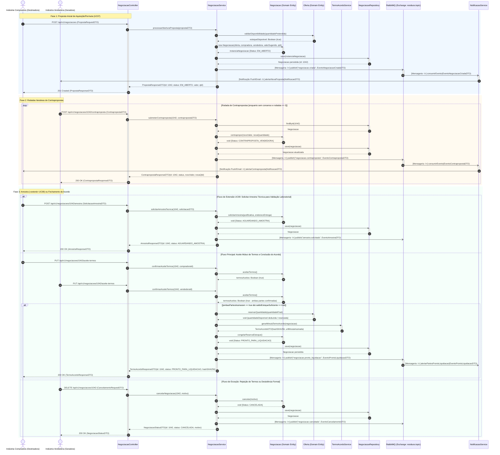
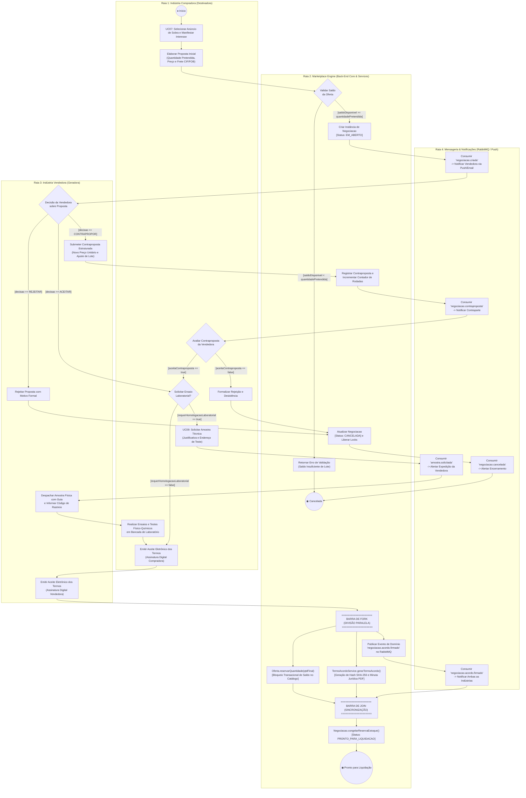
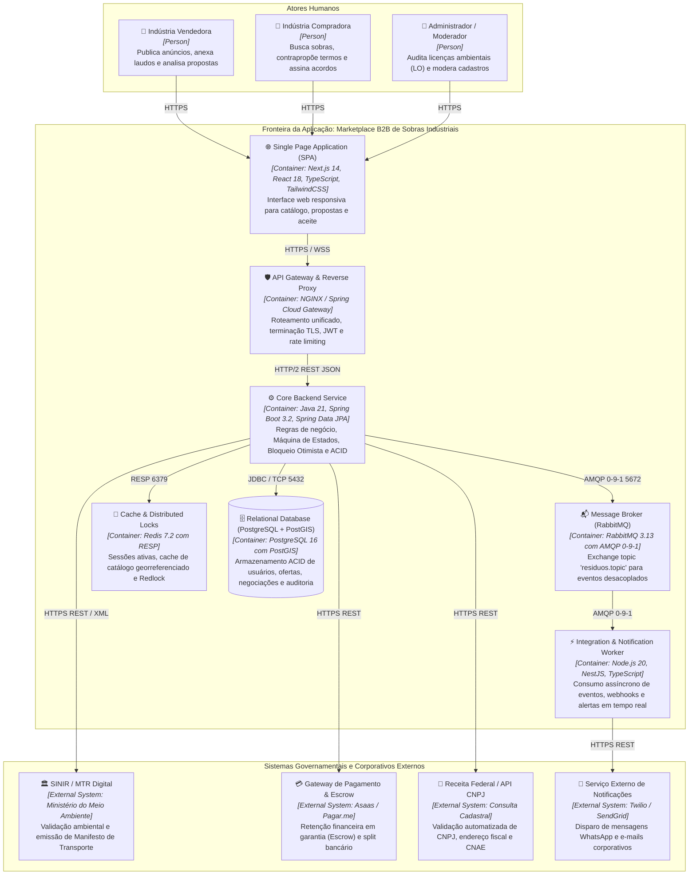

# Dossiê de Arquitetura Viva e Modelagem Comportamental as-Code
### Avaliação Prática Supervisionada (APS 3) — Individual (10% da Média Semestral)
**Curso:** Engenharia de Software (4º Período) — UniSenai  
**Unidade Curricular:** Modelagem de Software  
**Docente:** Prof. Sidney L. da Silva  
**Estudante:** Vitor Silva  
**Repositório Oficial:** [GitHub - Viktorkrl/MODELAGEMSFTWR](https://github.com/Viktorkrl/MODELAGEMSFTWR)  
**Projeto Integrador:** Marketplace B2B de Sobras Industriais — Polo CIC (Cidade Industrial de Curitiba)  
**Equipe de Origem (Sprint 2):** Grupo BTM (Kauan Oliveira, Vitor Silva, João Gabriel, Yudi)  

---

## 1. Apresentação e Seleção da Funcionalidade Crítica

Na Engenharia de Software contemporânea, a documentação estática desvinculada do código fonte é uma das principais fontes de falhas estruturais em projetos de missão crítica, originando o fenômeno da **Deriva Arquitetural (*Architectural Drift*)**. O paradigma de **Diagrams-as-Code (DaC)** e **Models-as-Code (MaC)** estabelece que arquiteturas e modelos comportamentais devem ser versionados, declarativos, automatizáveis e integrados ao ciclo de vida de desenvolvimento contínuo (CI/CD).

### 1.1 Domínio e Recorte Selecionado
* **Domínio de Negócio:** Marketplace B2B para Comercialização e Permuta de Sobras Fabris e Subprodutos Industriais no Polo CIC.
* **Funcionalidade Crítica Selecionada:** **Negociação B2B — Proposta, Contraproposta, Amostra Técnica e Termo de Acordo, culminando no estado "Pronto para Liquidação"** (Englobando os Casos de Uso **UC07, UC08 e UC09**, com interface para o **UC10**).
* **Entidade de Domínio Core:** `Negociacao` (agregada à entidade `Oferta`).

### 1.2 Justificativa de Criticidade de Negócio e Governança Ambiental
A negociação de resíduos e sobras fabris não pode ser modelada como um e-commerce de varejo simplificado. No contexto de sobras químicas, poliméricas e aparas metálicas:
1. **Lotes Heterogêneos e Finitos:** Cada lote gerado na planta possui laudo laboratorial específico e volume fixo. Não há reposição automática de prateleira.
2. **Compliance Normativo Rígido:** A transação é subordinada à **Política Nacional de Resíduos Sólidos (Lei Federal nº 12.305/2010 - PNRS)** e à norma **ABNT NBR 10004** (Classificação de Resíduos Sólidos em Classe I - Perigosos, Classe IIA - Não Inertes e Classe IIB - Inertes).
3. **Prevenção contra Overbooking:** Múltiplas indústrias transformadoras concorrem pelo mesmo lote residual. Se a plataforma permitir que duas compradoras fechem acordos simultâneos que excedam o saldo físico da sobra anunciada, configura-se fraude operacional e infração ambiental passível de sanções pelo IAT e IBAMA.
4. **Validação de Amostra Prévia («extend» UC09):** Antes de firmar um acordo de toneladas de subprodutos químicos ou plásticos, a compradora pode exigir remessa de amostra física para testes em bancada de laboratório. O sistema deve congelar o fluxo sem bloquear os recursos computacionais do banco de dados.

---

## 2. Estrutura de Governança dos Artefatos (Tree as-Code)

```text
aps3-vitor-silva/
├── docs/
│   ├── architecture/
│   │   ├── workspace.dsl         <-- Código Structurizr DSL (C4 Model Nível 2)
│   │   └── adr-0001.md           <-- Registro de Decisão Arquitetural (Formato Nygard)
│   └── diagrams/
│       ├── sequencia.mmd         <-- Código Mermaid do Diagrama de Sequência UML
│       ├── atividades.mmd        <-- Código Mermaid do Diagrama de Atividades com Raias
│       └── estados.mmd            <-- Código Mermaid da Máquina de Estados (State Machine)
└── README.md                     <-- Dossiê Executivo Consolidado e Renderizado
```

---

## 3. Artefato 1: Diagrama de Sequência (UML / DaC)

### 3.1 Objetivo Técnico
Mapear a troca cronológica de mensagens entre instâncias em tempo de execução para os casos de uso **UC07 (Manifestar Interesse)**, **UC08 (Negociar Condições e Termos)** e a extensão condicional **UC09 (Solicitar Amostra Técnica)**, culminando no fechamento do **Termo de Acordo** e habilitação para liquidação.

### 3.2 Diagrama Renderizado (Mermaid)



### 3.3 Catálogo de DTOs e Conformidade de Operações Públicas

| DTO Utilizado | Camada / Direção | Campos Principais | Finalidade de Domínio |
| :--- | :--- | :--- | :--- |
| `PropostaRequestDTO` | Inbound (Compradora -> Controller) | `ofertaId`, `quantidadePretendida`, `valorUnitarioSugerido`, `modalidadeFrete`, `mensagemInicial` | Início formal da negociação de compra ou permuta. |
| `PropostaResponseDTO` | Outbound (Service -> Controller -> Compradora) | `negociacaoId`, `status: EM_ABERTO`, `valorUnitarioSugerido`, `quantidadePretendida`, `dataInicio` | Retorno seguro dos metadados da negociação aberta. |
| `ContrapropostaDTO` | Inbound (Partes -> Controller) | `novoValorUnitario`, `novaQuantidade`, `modalidadeFrete`, `observacoes` | Ajuste bilateral de preço, volume ou frete. |
| `ContrapropostaResponseDTO` | Outbound (Service -> Controller) | `negociacaoId`, `status`, `valorFinalUnitario`, `quantidadeFinal`, `rodadaAtual` | Confirmação da rodada de contraproposta. |
| `SolicitacaoAmostraDTO` | Inbound (Compradora -> Controller) | `quantidadeAmostra`, `enderecoEntrega`, `justificativaTecnica` | Solicitação de ensaio prévio (UC09). |
| `TermoAcordoResponseDTO` | Outbound (Service -> Controller -> Partes) | `negociacaoId`, `status: PRONTO_PARA_LIQUIDACAO`, `hashSHA256`, `urlMinutaAssinada` | Acordo consolidado habilitado para Escrow e MTR. |

> **Regra de Consistência Absoluta:** Todas as mensagens enviadas para as entidades `Negociacao` (`contrapropor`, `aceitarTermos`, `congelarReservaEstoque`, `cancelar`) e `Oferta` (`validarDisponibilidade`, `reservarQuantidade`) correspondem com exatidão matemática às operações públicas declaradas no Diagrama de Classes e Dicionário de Domínio da Sprint 2.

---

## 4. Artefato 2: Diagrama de Atividades com Raias (UML / DaC)

### 4.1 Objetivo Técnico
Mapear o fluxo de trabalho (*workflow*) do processo de negociação, evidenciando as raias de responsabilidade (atores humanos, regras de negócio e mensageria externa), nós de decisão com condições de guarda booleanas mutuamente exclusivas e a concorrência através de uma **Barra de Fork** e **Barra de Join**.

### 4.2 Diagrama Renderizado (Mermaid)



### 4.3 Análise de Concorrência e Sincronização (Fork & Join)
Quando o duplo aceite eletrônico do Termo de Acordo é concluído, o sistema dispara a **Barra de Fork**, particionando três tarefas críticas que rodam de forma concorrente:
1. **Ramo A (Consistência Transacional de Estoque):** Bloqueia e subtrai atomicamente o volume acordado do saldo da `Oferta` no PostgreSQL via Bloqueio Otimista, impedindo sobreposição de compras por concorrentes.
2. **Ramo B (Conformidade Jurídica e Hash Criptográfico):** O `TermoAcordoService` consolida a minuta contratual em PDF, incluindo as cláusulas ambientais da PNRS, e gera o hash criptográfico SHA-256 da assinatura digital das partes.
3. **Ramo C (Reatividade e Mensageria Assíncrona):** Publica o evento `negociacao.acordo.firmado` no RabbitMQ para que os consumidores externos preparem o ambiente de custódia (Escrow) e as notificações push/e-mail para os diretores fabris.
* A **Barra de Join** sincroniza o término bem-sucedido dessas três frentes antes de consolidar a entidade `Negociacao` no estado definitivo `PRONTO_PARA_LIQUIDACAO`.

---

## 5. Artefato 3: Diagrama de Transição de Estados (State Machine / DaC)

### 5.1 Objetivo Técnico
Mapear o ciclo de vida rigoroso da entidade central `Negociacao`, especificando estados compostos (subestados), condições de guarda booleanas, ações de efeito e os compartimentos internos de execução (`entry /`, `do /`, `exit /`).

### 5.2 Diagrama Renderizado (Mermaid `stateDiagram-v2`)

```mermaid
stateDiagram-v2
    [*] --> Aberta : manifestarInteresse [ofertaAtiva == true] / instanciarNegociacao()

    Aberta --> EmNegociacao : submeterProposta [saldoDisponivel >= qtd && valorUnitario > 0] / registrarPropostaInicial()
    Aberta --> Cancelada : desistirAbertura [semProposta == true] / registrarDesistencia()

    %% ESTADO COMPOSTO: EM NEGOCIAÇÃO
    state EmNegociacao {
        [*] --> AguardandoAnaliseVendedora
        
        AguardandoAnaliseVendedora --> ContrapropostaVendedora : contrapropor [rodada < 3 && novoValor > 0] / registrarHistoricoContraproposta()
        ContrapropostaVendedora --> AguardandoAnaliseCompradora : notificarContraparte()
        
        AguardandoAnaliseCompradora --> ContrapropostaCompradora : contrapropor [rodada < 3 && novoValor > 0] / registrarHistoricoContraproposta()
        ContrapropostaCompradora --> AguardandoAnaliseVendedora : notificarContraparte()
        
        %% Subfluxo: Homologação de Amostra Técnica (UC09)
        AguardandoAnaliseVendedora --> AguardandoHomologacaoAmostra : solicitarAmostraTecnica [isResiduoClasseI == true && laudoExigeEnsaio == true] / emitirGuiaRemessaAmostra()
        AguardandoHomologacaoAmostra --> AguardandoAnaliseVendedora : aprovarLaudoAmostra [amostraConforme == true] / registrarHomologacaoBancada()
        AguardandoHomologacaoAmostra --> Cancelada : reprovarLaudoAmostra [amostraNaoConforme == true] / emitirParecerIncompatibilidade()

        %% Consenso das Cláusulas
        AguardandoAnaliseVendedora --> TermosConsensados : aceitarTermos [consensoPrecoVolume == true] / emitirMinutaTermoAcordo()
        AguardandoAnaliseCompradora --> TermosConsensados : aceitarTermos [consensoPrecoVolume == true] / emitirMinutaTermoAcordo()
        
        TermosConsensados --> ProntoParaLiquidacao : confirmarAceiteMutuo [ambasPartesAssinaram == true && saldoEstoqueSuficiente == true] / congelarEstoqueEGarantirSLA()
    }

    %% Compartimento de Ações Internas (entry / do / exit)
    EmNegociacao : entry / registrarAuditoriaAbertura()
    EmNegociacao : do / monitorarSlaExpiracao48h()
    EmNegociacao : exit / desarmarTimerSla()

    %% Transições de Exceção e SLA
    EmNegociacao --> Cancelada : cancelarNegociacao [motivoInformado == true] / liberarLocksConcorrentes()
    EmNegociacao --> Expirada : timeOutSla [tempoDecorrido > 48h] / notificarPartesExpiracao()
    EmNegociacao --> InterrompidaPorTerceiro : loteEsgotadoPorTerceiro [saldoRemanescente == 0] / abortarNegociacaoConcorrente()

    %% ESTADO PRONTO PARA LIQUIDAÇÃO
    state ProntoParaLiquidacao {
        [*] --> AguardandoInicioEscrow
        AguardandoInicioEscrow --> HabilitadaParaTransacao : gerarPayloadTransacao()
    }

    ProntoParaLiquidacao : entry / persistirHashContratualSHA256()
    ProntoParaLiquidacao : do / exporEndpointLiquidacaoUC10()
    ProntoParaLiquidacao : exit / instanciarTransacaoB2B()

    %% Transição para Fechamento de Transação
    ProntoParaLiquidacao --> ConcluidaParaTransacao : transicionarParaUC10 [iniciarCustodiaEscrow == true] / instanciarTransacao()

    ConcluidaParaTransacao --> [*]
    Cancelada --> [*]
    Expirada --> [*]
    InterrompidaPorTerceiro --> [*]
```

### 5.3 Formalismo Matemático das Transições e Ações Internas

$$\text{Transição Formal: } \text{Origem} \xrightarrow{\text{Gatilho } [\text{CondiçãoDeGuarda}] \ / \ \text{AçãoDeEfeito}()} \text{Destino}$$

1. **Transição de Contraproposta:**  
   $$\text{AguardandoAnalise} \xrightarrow{\text{contrapropor } [\text{rodada} < 3 \land \text{novoValor} > 0] \ / \ \text{registrarHistoricoContraproposta}()} \text{ContrapropostaPendente}$$
2. **Transição para Amostra Técnica («extend» UC09):**  
   $$\text{AguardandoAnaliseVendedora} \xrightarrow{\text{solicitarAmostraTecnica } [\text{isResiduoClasseI} == \text{true} \land \text{laudoExigeEnsaio} == \text{true}] \ / \ \text{emitirGuiaRemessaAmostra}()} \text{AguardandoHomologacaoAmostra}$$
3. **Transição de Acordo Consolidado:**  
   $$\text{TermosConsensados} \xrightarrow{\text{confirmarAceiteMutuo } [\text{ambasPartesAssinaram} == \text{true} \land \text{saldoEstoqueSuficiente} == \text{true}] \ / \ \text{congelarEstoqueEGarantirSLA}()} \text{ProntoParaLiquidacao}$$
4. **Compartimentos Internos do Estado `EmNegociacao`:**
   * `entry / registrarAuditoriaAbertura()`: Cria o snapshot imutável com carimbo de tempo para auditoria judicial.
   * `do / monitorarSlaExpiracao48h()`: Thread de background que monitora a inatividade de respostas.
   * `exit / desarmarTimerSla()`: Cancela os timers pendentes ao ocorrer decisão ou fechamento.

---

## 6. Artefato 4: Visão Arquitetural Macro C4 (Models-as-Code / DaC)

### 6.1 Objetivo Técnico
Representar a topologia física e lógica dos contêineres que compõem o sistema (**C4 Model — Nível 2**), identificando tecnologias, bancos de dados, mensageria e protocolos de integração.

### 6.2 Diagrama de Contêineres Renderizado (Mermaid C4)



### 6.3 Especificação dos Contêineres e Protocolos

| Contêiner / Unidade | Tecnologia Adotada | Protocolo / Porta | Responsabilidade de Arquitetura |
| :--- | :--- | :--- | :--- |
| **Single Page Application** | Next.js 14, React 18, TypeScript | HTTPS / WSS (Porta 443) | Interface com o usuário, renderização SSR/SSG e chat em tempo real via WebSockets. |
| **API Gateway** | NGINX / Spring Cloud Gateway | HTTP/2 REST (Porta 8080) | Ponto único de entrada, validação de tokens JWT (OAuth2) e prevenção contra ataques DDoS. |
| **Core Backend Service** | Java 21, Spring Boot 3.2, JPA | TCP / HTTP/2 Interno | Processamento transacional, execução da máquina de estados e controle de bloqueio otimista (`@Version`). |
| **Integration Worker** | Node.js 20, NestJS, TypeScript | AMQP 0-9-1 (Porta 5672) | Consumo assíncrono de eventos de domínio, geração de PDFs em background e despacho para webhooks. |
| **Message Broker** | RabbitMQ 3.13 | AMQP 0-9-1 (Porta 5672) | Roteamento desacoplado de eventos com Dead Letter Queues (DLQ) para tolerância a falhas. |
| **Cache & Lock Store** | Redis 7.2 | RESP (Porta 6379) | Cache georreferenciado com consultas de raio de proximidade e travas distribuídas (*Redlock*). |
| **Database Relacional** | PostgreSQL 16 + PostGIS | JDBC / TCP (Porta 5432) | Persistência relacional ACID, indexação espacial `GIST` para logística do Polo CIC. |

> O código-fonte declarativo formal para Structurizr DSL encontra-se disponível no arquivo [`docs/architecture/workspace.dsl`](./docs/architecture/workspace.dsl).

---

## 7. Artefato 5: Registro de Decisão Arquitetural (ADR 0001)

A decisão arquitetural foi documentada seguindo o rigoroso **Formato Nygard**, disponível na íntegra em [`docs/architecture/adr-0001.md`](./docs/architecture/adr-0001.md). A seguir, apresenta-se a síntese executiva:

* **Título:** ADR 0001 — Padrão State com Bloqueio Otimista (@Version) e Outbox Pattern com RabbitMQ para Negociações B2B Concorrentes de Sobras Industriais
* **Status:** **Aprovado**
* **Contexto:** Lotes finitos de sobras e subprodutos industriais (resíduos químicos Classe I, sucatas ferrosas e plásticos de engenharia do Polo CIC) atraem múltiplos compradores concorrentes. Negociações humanas duram horas ou dias (SLA de 48h). O uso de travas pessimistas no banco de dados (`SELECT FOR UPDATE`) causaria gargalos severos de conexões e deadlocks. Em contrapartida, a falta de bloqueio causaria sobreposição de vendas (*overbooking*), violando a Lei Federal nº 12.305/2010 (PNRS) e gerando severa responsabilidade cível e ambiental.
* **Decisão:**
  1. Implementação do **Padrão State (GoF)** na entidade JPA `Negociacao` para blindar transições inválidas.
  2. Adoção de **Bloqueio Otimista (`@Version`)** nas entidades `Oferta` e `Negociacao`, permitindo concorrência sem bloqueio de threads até o instante atômico do aceite mútuo dos termos. Em caso de colisão, a operação secundária é reavaliada via `@Retryable` ou abortada com aviso gracioso.
  3. Aplicação do **Transactional Outbox Pattern** associado ao message broker **RabbitMQ** para publicação garantida do evento de domínio `negociacao.acordo.firmado`, desacoplando geração de hashes SHA-256 e disparos de notificações push/e-mail.
* **Consequências:** Eliminação matemática de *overbooking*, altíssimo throughput transacional, auditoria temporal estrita para órgãos reguladores (IAT/IBAMA) e desacoplamento de integrações externas pesadas.

---

## 8. Matriz de Consistência Bidirecional entre os Modelos

| Elemento do Domínio | Diagrama de Sequência (Artefato 1) | Diagrama de Atividades (Artefato 2) | Diagrama de Estados (Artefato 3) | C4 Model Contêineres (Artefato 4) |
| :--- | :--- | :--- | :--- | :--- |
| **Manifestação de Interesse (UC07)** | `POST /api/v1/negociacoes` | Atividade: "Manifestar Interesse" na Raia Compradora | Transição `[*] --> Aberta` | SPA (Next.js) -> API Gateway -> Core Backend |
| **Contraproposta (UC08)** | `loop Rodada de Contrapropostas` com `contrapropor(v, q)` | Atividade: "Submeter Contraproposta Estruturada" | Subestado `ContrapropostaVendedora` | Core Backend (Spring Boot) -> PostgreSQL (`@Version`) |
| **Amostra Técnica («extend» UC09)** | Fragmento `alt: Solicitar Amostra Técnica` | Decisão: `[requerHomologacaoLaboratorial == true]` | Subestado `AguardandoHomologacaoAmostra` | Core Backend -> Worker (NestJS) -> Alerta de Expedição |
| **Fork / Join de Fechamento** | `reservarQuantidade(q)` + `gerarMinutaTermoAcordo()` | Barra de Fork com 3 ramos paralelos e Barra de Join | Ação de Efeito `/ congelarEstoqueEGarantirSLA()` | Core Backend + PostgreSQL + RabbitMQ (AMQP) |
| **Status Final da Funcionalidade** | Retorno de `TermoAcordoResponseDTO` | Nó de Fim: `Pronto para Liquidação` | Estado `ProntoParaLiquidacao` com `entry/`, `do/`, `exit/` | Habilita endpoints de liquidação para UC10 (Escrow / SINIR) |

---

## 9. Instruções de Compilação, Governança as-Code e Auditoria

Os diagramas deste projeto foram construídos no padrão texto puro declarativo, possibilitando validação sintática contínua por ferramentas de linha de comando:

1. **Validação de Sintaxe Mermaid:**
   ```bash
   # Instalação do compilador oficial Mermaid CLI
   npm install -g @mermaid-js/mermaid-cli

   # Compilação e renderização dos diagramas em SVG / PNG
   mmdc -i docs/diagrams/sequencia.mmd -o docs/diagrams/sequencia.svg
   mmdc -i docs/diagrams/atividades.mmd -o docs/diagrams/atividades.svg
   mmdc -i docs/diagrams/estados.mmd -o docs/diagrams/estados.svg
   ```

2. **Validação do Modelo C4 via Structurizr CLI:**
   ```bash
   # Validação do arquivo workspace.dsl
   structurizr-cli validate -w docs/architecture/workspace.dsl

   # Exportação do modelo para Mermaid / PlantUML
   structurizr-cli export -w docs/architecture/workspace.dsl -f mermaid
   ```

---
*Dossiê elaborado em conformidade estrita com as diretrizes da Unidade Curricular de Modelagem de Software (UniSenai - 2026).*
